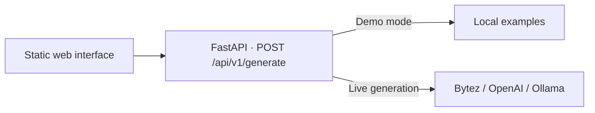

# QueryCraft AI

**English** · [Русский](README_RU.md)

QueryCraft AI turns natural-language descriptions in English or Russian into draft queries for PostgreSQL, MySQL, SQLite, and MongoDB. The API returns the query text, an explanation, and generation metadata. It does not connect to a database or execute queries. Review each draft against your schema and requirements before using it.

[Project guide](Docs/README.md) · [Technical guide](Docs/technical.md) · [Generation providers](Docs/providers.md)

## Architecture



- **API** validates requests with Pydantic v2 and enforces request size and rate limits. Each FastAPI worker owns an asynchronous HTTPX client and connection pool.
- **Generation** sends the description and optional schema context to the configured provider, then checks the returned syntax for the selected dialect. Ollama runs locally without a key. Demo mode returns predefined examples.
- **Web interface** uses HTML, CSS, and JavaScript and runs without a build step. Syntax highlighting renders provider output as text in the DOM.

## Run locally

Use Python 3.12 or 3.13. Node.js and npm are required for frontend checks. Run the following Bash commands from the repository root.

```bash
python3 -m venv .venv
source .venv/bin/activate
python -m pip install -r backend/requirements-dev.txt
```

Choose a provider on the backend. Bytez is the default. For OpenAI set `GENERATION_PROVIDER=openai` and configure `QUERYCRAFT_OPENAI_API_KEY` or `OPENAI_API_KEY`. For Ollama set `GENERATION_PROVIDER=ollama` after starting Ollama and pulling its model. [Provider setup](Docs/providers.md)

Put the selected settings in the environment or in `backend/.env`, then start the API from `backend/`.

```bash
cd backend
python -m uvicorn app.main:app --host 127.0.0.1 --port 8000 --reload
```

To try the interface without a model service, prefix the command with `GENERATION_MODE=demo`. The interface labels those results as examples.

In a second terminal, start the static server from the repository root.

```bash
python3 -m http.server --bind 127.0.0.1 --directory frontend/public 3000
```

Open `http://localhost:3000`. The browser sends requests to `http://localhost:8000/api/v1`. The page loads Tailwind styles, Swiper, and Google Fonts from external CDNs.

## HTTP API

| Route | Purpose |
| --- | --- |
| `POST /api/v1/generate` | Generate a draft query |
| `GET /health` | Check API availability |
| `GET /api/v1/health` | Report API status and the configured model without contacting the provider |
| `GET /api/docs` | Swagger UI |
| `GET /api/redoc` | ReDoc |
| `GET /openapi.json` | OpenAPI schema |

### Generate a query

```bash
curl --fail-with-body --silent --show-error http://127.0.0.1:8000/api/v1/generate \
  -H 'Content-Type: application/json' \
  --data '{"text":"Show active users older than 25","db_type":"postgresql","complexity":"simple","language":"en","schema_context":"users(id, username, email, age, status, created_at)"}'
```

| Field | Accepted values | Default |
| --- | --- | --- |
| `text` | String of 3–1000 characters after trimming leading and trailing whitespace | Required |
| `db_type` | `postgresql`, `mysql`, `sqlite`, `mongodb` | `postgresql` |
| `complexity` | `simple`, `medium`, `advanced` | `medium` |
| `language` | `ru`, `en` | `ru` |
| `schema_context` | Optional schema description with table or collection names, fields, and relationships, up to 3000 characters | Omitted |

Example response in demo mode.

```json
{
  "query": "SELECT id, username, email, age, status, created_at\nFROM users\nWHERE status = 'active' AND age > 25\nORDER BY created_at DESC\nLIMIT 100;",
  "explanation": "Selects active users older than 25",
  "executed_in": 0.0,
  "tokens_used": 150,
  "model": "Qwen/Qwen2-7B-Instruct (тестовый режим)",
  "source": "demo",
  "provider": null
}
```

`executed_in` is measured in seconds. A generated query has `source: "live"` and a `provider` of `bytez`, `openai`, or `ollama`. A predefined example has `source: "demo"`, `provider: null`, and a placeholder `tokens_used` value.

| Status | Meaning |
| --- | --- |
| `413` | Request body exceeds 64 KiB |
| `422` | Invalid JSON or request fields |
| `429` | Generation rate limit reached. See the `Retry-After` header |
| `502` | Provider failure, invalid response format, or output the dialect parser rejected |
| `503` | The selected cloud provider's key is missing |
| `504` | Provider request timed out |

## Configuration

The application reads environment variables and a `.env` file in the server’s working directory. Use `backend/.env` when starting the server from `backend/`. Environment variables take precedence.

| Variable | Default | Purpose |
| --- | --- | --- |
| `GENERATION_MODE` | `live` | Use `demo` to return predefined examples in development |
| `GENERATION_PROVIDER` | `bytez` | Select `bytez`, `openai`, or `ollama` |
| `BYTEZ_API_KEY` | Unset | Key for Bytez. With Bytez selected, the legacy value `your_api_key_here` selects demo mode |
| `QUERYCRAFT_OPENAI_API_KEY` / `OPENAI_API_KEY` | Unset | Key for OpenAI. QueryCraft's scoped variable takes precedence |
| `BYTEZ_API_URL` | `https://api.bytez.com/models/v2/openai/v1` | Bytez HTTPS base URL |
| `OLLAMA_API_URL` | `http://127.0.0.1:11434/v1` | Ollama's OpenAI-compatible base URL |
| `MODEL_NAME` | Provider default | Override the selected provider's model |
| `API_TIMEOUT` | `30` | Total provider request timeout in seconds, from 5 to 120 |
| `ALLOWED_ORIGINS` | Local origins on ports 3000 and 8000 | Allowed CORS origins as a JSON array or comma-separated list |
| `MAX_QUERY_LENGTH` | `1000` | Maximum description length, from 3 to 1000 characters |
| `MAX_REQUESTS_PER_MINUTE` | `60` | Shared generation request limit per minute, per worker |
| `ENVIRONMENT` | `development` | Production requires live mode and `DEBUG=false`. Cloud providers also require a key |
| `DEBUG` | `false` | Development configuration flag |
| `APP_NAME` | `QueryCraft AI` | Application name shown in the API documentation title |

Live mode sends query descriptions and any supplied schema context to the selected provider. With Ollama on the API host, those requests stay on that host. Keep API keys out of version control.

For a hosted deployment, configure the frontend to use an API address reachable by the browser and include the frontend origin in `ALLOWED_ORIGINS`. If you run multiple workers, enforce a shared rate limit and access control at the gateway. [Technical guide](Docs/technical.md)

## Development checks

Run the backend checks from the repository root with the virtual environment activated.

```bash
python -m pytest -q
ruff check backend
ruff format --check backend
mypy
```

With the API running in demo mode, run `python backend/cors_test.py` to verify CORS and generation over HTTP. The provider tests use a mock HTTP transport and require no API keys or local model.

Run the frontend checks from the repository root.

```bash
cd frontend
npm install
npm run lint
npm test -- --runInBand
```

## Repository structure

| Path | Purpose |
| --- | --- |
| [`backend/app/main.py`](backend/app/main.py) | FastAPI application factory and lifecycle |
| [`backend/app/api/v1/endpoints/query.py`](backend/app/api/v1/endpoints/query.py) | Generation endpoints, health checks, and request limits |
| [`backend/app/config.py`](backend/app/config.py) | Application settings and validation |
| [`backend/app/models/schemas.py`](backend/app/models/schemas.py) | Request and response schemas |
| [`backend/app/services/ai_service.py`](backend/app/services/ai_service.py) | Provider integration and demo examples |
| [`backend/tests/`](backend/tests/) | API, configuration, and provider tests |
| [`frontend/public/`](frontend/public/) | Static web assets |
| [`frontend/tests/`](frontend/tests/) | Browser JavaScript tests |

## Developer

Developed by [Artem7898](https://github.com/Artem7898).
