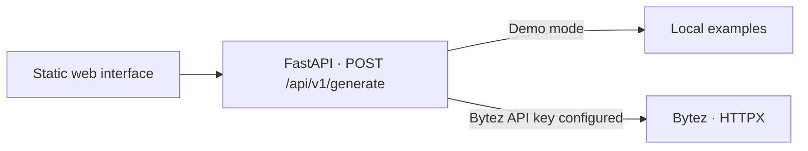

# QueryCraft AI

**English** · [Русский](README_RU.md)

QueryCraft AI turns natural-language descriptions in English or Russian into draft queries for PostgreSQL, MySQL, SQLite, and MongoDB. The API returns the query text, an explanation, and generation metadata. It does not connect to a database or execute queries. Review each draft against your schema and requirements before using it.

## Architecture



- **API** validates requests with Pydantic v2 and enforces request size and rate limits. Each FastAPI worker owns an asynchronous HTTPX client and connection pool.
- **Generation** uses Bytez with `Qwen/Qwen2-7B-Instruct` as the default model. Demo mode returns predefined examples for the selected database dialect.
- **Web interface** uses HTML, CSS, and JavaScript and runs without a build step. Syntax highlighting renders provider output as text in the DOM.

## Run locally

Use Python 3.12 or 3.13. Node.js and npm are required for frontend checks. Run the following Bash commands from the repository root.

```bash
python3 -m venv .venv
source .venv/bin/activate
python -m pip install -r backend/requirements-dev.txt
```

Start the API from `backend/`. This command explicitly enables demo mode and requires no Bytez key.

```bash
cd backend
BYTEZ_API_KEY=your_api_key_here python -m uvicorn app.main:app --host 127.0.0.1 --port 8000 --reload
```

In a second terminal, start the static server from the repository root.

```bash
python3 -m http.server --bind 127.0.0.1 --directory frontend/public 3000
```

Open `http://localhost:3000`. The browser sends requests to `http://localhost:8000/api/v1`. The page loads Tailwind styles, Swiper, and Google Fonts from external CDNs.

## HTTP API

| Route | Purpose |
| --- | --- |
| `POST /api/v1/generate` | Generate a draft query |
| `GET /health` | Check API availability |
| `GET /api/v1/health` | Report API status and the configured model without contacting Bytez |
| `GET /api/docs` | Swagger UI |
| `GET /api/redoc` | ReDoc |
| `GET /openapi.json` | OpenAPI schema |

### Generate a query

```bash
curl --fail-with-body --silent --show-error http://127.0.0.1:8000/api/v1/generate \
  -H 'Content-Type: application/json' \
  --data '{"text":"Show active users older than 25","db_type":"postgresql","complexity":"simple","language":"en"}'
```

| Field | Accepted values | Default |
| --- | --- | --- |
| `text` | String of 3–1000 characters after trimming leading and trailing whitespace | Required |
| `db_type` | `postgresql`, `mysql`, `sqlite`, `mongodb` | `postgresql` |
| `complexity` | `simple`, `medium`, `advanced` | `medium` |
| `language` | `ru`, `en` | `ru` |

Example response in demo mode.

```json
{
  "query": "SELECT id, username, email, age, status, created_at\nFROM users\nWHERE status = 'active' AND age > 25\nORDER BY created_at DESC\nLIMIT 100;",
  "explanation": "Selects active users older than 25",
  "executed_in": 0.0,
  "tokens_used": 150,
  "model": "Qwen/Qwen2-7B-Instruct (тестовый режим)"
}
```

`executed_in` is measured in seconds. In demo mode, `tokens_used` is a placeholder value and the model name includes the suffix `(тестовый режим)`, meaning “demo mode.”

| Status | Meaning |
| --- | --- |
| `413` | Request body exceeds 16 KiB |
| `422` | Invalid JSON or request fields |
| `429` | Generation rate limit reached. See the `Retry-After` header |
| `502` | Provider failure or unexpected response format |
| `504` | Provider request timed out |

## Configuration

The application reads environment variables and a `.env` file in the server’s working directory. Use `backend/.env` when starting the server from `backend/`. Environment variables take precedence.

| Variable | Default | Purpose |
| --- | --- | --- |
| `BYTEZ_API_KEY` | Unset | API key for live generation. An empty value or `your_api_key_here` enables demo mode |
| `BYTEZ_API_URL` | `https://api.bytez.com/models/v2/openai/v1` | Provider HTTPS base URL |
| `MODEL_NAME` | `Qwen/Qwen2-7B-Instruct` | Provider model identifier |
| `API_TIMEOUT` | `30` | Total Bytez request timeout in seconds, from 5 to 120 |
| `ALLOWED_ORIGINS` | Local origins on ports 3000 and 8000 | Allowed CORS origins as a JSON array or comma-separated list |
| `MAX_QUERY_LENGTH` | `1000` | Maximum description length, from 3 to 1000 characters |
| `MAX_REQUESTS_PER_MINUTE` | `60` | Shared generation request limit per minute, per worker |
| `ENVIRONMENT` | `development` | The `production` setting requires a Bytez key and `DEBUG=false` |
| `DEBUG` | `false` | Development configuration flag |
| `APP_NAME` | `QueryCraft AI` | Application name shown in the API documentation title |

To enable live generation, configure your Bytez key in the environment or in your local `.env` file and remove `BYTEZ_API_KEY=your_api_key_here` from the startup command. Live mode sends query descriptions to Bytez. Keep the API key out of version control.

For a hosted deployment, set `API_BASE_URL` to an API address reachable by the browser and include the frontend origin in `ALLOWED_ORIGINS`. If you run multiple workers, enforce a shared rate limit and access control at the gateway. [Frontend API configuration](frontend/public/assets/js/main.js)

## Development checks

Run the backend checks from the repository root with the virtual environment activated.

```bash
python -m pytest -q
ruff check backend
ruff format --check backend
mypy
```

With the API running in demo mode, run `python backend/cors_test.py` to verify CORS and generation over HTTP. The provider tests use a mock HTTP transport and require no Bytez key.

Run the frontend checks from the repository root.

```bash
cd frontend
npm install
npm run lint
npm test -- --runInBand
```

## Repository structure

| Path | Purpose |
| --- | --- |
| [`backend/app/main.py`](backend/app/main.py) | FastAPI application factory and lifecycle |
| [`backend/app/api/v1/endpoints/query.py`](backend/app/api/v1/endpoints/query.py) | Generation endpoints, health checks, and request limits |
| [`backend/app/config.py`](backend/app/config.py) | Application settings and validation |
| [`backend/app/models/schemas.py`](backend/app/models/schemas.py) | Request and response schemas |
| [`backend/app/services/ai_service.py`](backend/app/services/ai_service.py) | Bytez integration and demo examples |
| [`backend/tests/`](backend/tests/) | API, configuration, and provider tests |
| [`frontend/public/`](frontend/public/) | Static web assets |
| [`frontend/tests/`](frontend/tests/) | Browser JavaScript tests |

## Developer

Developed by [Artem7898](https://github.com/Artem7898).
