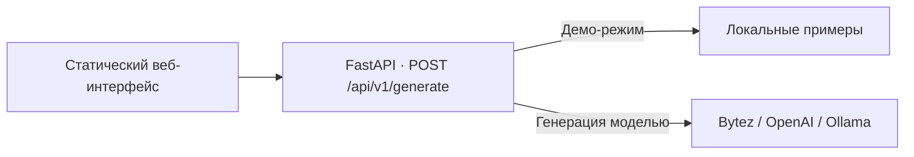

# QueryCraft AI

[English](README.md) · **Русский**

QueryCraft AI превращает описание на русском или английском в черновик запроса для PostgreSQL, MySQL, SQLite или MongoDB. API возвращает текст запроса, пояснение и метаданные генерации. Приложение не подключается к СУБД и не выполняет запросы. Перед использованием сверьте результат со схемой данных и требованиями задачи.

[Руководство по проекту](Docs/README_RU.md) · [Техническое руководство](Docs/technical_RU.md) · [Провайдеры генерации](Docs/providers_RU.md)

## Архитектура



- **API** проверяет входные данные через Pydantic v2, ограничивает размер и частоту запросов. Асинхронный клиент HTTPX и пул соединений живут в пределах одного процесса FastAPI.
- **Генерация** отправляет описание и необязательный контекст схемы выбранному провайдеру, затем проверяет синтаксис результата для выбранной СУБД. Ollama работает локально без ключа. В деморежиме доступны готовые примеры.
- **Веб-интерфейс** работает на HTML, CSS и JavaScript без этапа сборки. Подсветка отображает ответ провайдера как текст в DOM.

## Локальный запуск

Требуется Python 3.12 или 3.13. Node.js и npm нужны для проверок фронтенда. Команды ниже рассчитаны на Bash.

```bash
python3 -m venv .venv
source .venv/bin/activate
python -m pip install -r backend/requirements-dev.txt
```

Выберите провайдера на бэкенде. По умолчанию используется Bytez. Для OpenAI задайте `GENERATION_PROVIDER=openai` и `QUERYCRAFT_OPENAI_API_KEY` или `OPENAI_API_KEY`. Для Ollama запустите сервис модели, загрузите модель и задайте `GENERATION_PROVIDER=ollama`. [Настройка провайдеров](Docs/providers_RU.md)

Укажите настройки выбранного провайдера в окружении или в `backend/.env`, затем запустите API из каталога `backend/`.

```bash
cd backend
python -m uvicorn app.main:app --host 127.0.0.1 --port 8000 --reload
```

Чтобы попробовать интерфейс без сервиса модели, добавьте перед командой `GENERATION_MODE=demo`. Интерфейс помечает такие ответы как примеры.

Во втором терминале из корня репозитория запустите статический сервер.

```bash
python3 -m http.server --bind 127.0.0.1 --directory frontend/public 3000
```

Откройте страницу на `http://localhost:3000`. Браузер обращается к API на `http://localhost:8000/api/v1`. Для полной отрисовки стилей, шрифтов и карусели странице нужен доступ к CDN Tailwind, Swiper и Google Fonts.

## HTTP API

| Маршрут | Назначение |
| --- | --- |
| `POST /api/v1/generate` | Генерация черновика запроса |
| `GET /health` | Проверка доступности API |
| `GET /api/v1/health` | Состояние API и имя модели. Маршрут работает без запроса к провайдеру |
| `GET /api/docs` | Swagger UI |
| `GET /api/redoc` | ReDoc |
| `GET /openapi.json` | Схема OpenAPI |

### Запрос генерации

```bash
curl --fail-with-body --silent --show-error http://127.0.0.1:8000/api/v1/generate \
  -H 'Content-Type: application/json' \
  --data '{"text":"Show active users older than 25","db_type":"postgresql","complexity":"simple","language":"en","schema_context":"users(id, username, email, age, status, created_at)"}'
```

| Поле | Допустимые значения | По умолчанию |
| --- | --- | --- |
| `text` | Строка из 3–1000 символов после удаления пробелов по краям | Обязательное поле |
| `db_type` | `postgresql`, `mysql`, `sqlite`, `mongodb` | `postgresql` |
| `complexity` | `simple`, `medium`, `advanced` | `medium` |
| `language` | `ru`, `en` | `ru` |
| `schema_context` | Необязательное описание схемы с таблицами или коллекциями, полями и связями, до 3000 символов | Отсутствует |

Пример ответа в демо-режиме:

```json
{
  "query": "SELECT id, username, email, age, status, created_at\nFROM users\nWHERE status = 'active' AND age > 25\nORDER BY created_at DESC\nLIMIT 100;",
  "explanation": "Selects active users older than 25",
  "executed_in": 0.0,
  "tokens_used": 150,
  "model": "Qwen/Qwen2-7B-Instruct (тестовый режим)",
  "source": "demo",
  "provider": null
}
```

`executed_in` измеряется в секундах. У сгенерированного запроса `source: "live"` и `provider` со значением `bytez`, `openai` или `ollama`. У готового примера `source: "demo"`, `provider: null` и условное значение `tokens_used`.

| Статус | Причина |
| --- | --- |
| `413` | Тело запроса превышает 64 КиБ |
| `422` | Некорректный JSON или ошибка валидации полей |
| `429` | Исчерпан лимит генерации. Время ожидания указано в `Retry-After` |
| `502` | Ошибка провайдера, некорректный формат ответа или синтаксис, который отклонил парсер выбранного диалекта |
| `503` | Отсутствует ключ выбранного облачного провайдера |
| `504` | Истёк тайм-аут обращения к провайдеру |

## Конфигурация

Приложение читает переменные окружения и файл `.env` из рабочей директории процесса. При запуске из `backend/` используйте `backend/.env`. Переменные окружения имеют приоритет.

| Переменная | По умолчанию | Назначение |
| --- | --- | --- |
| `GENERATION_MODE` | `live` | Значение `demo` включает готовые примеры в среде разработки |
| `GENERATION_PROVIDER` | `bytez` | Выбор провайдера `bytez`, `openai` или `ollama` |
| `BYTEZ_API_KEY` | Не задана | Ключ Bytez. Для выбранного Bytez прежнее значение `your_api_key_here` включает деморежим |
| `QUERYCRAFT_OPENAI_API_KEY` / `OPENAI_API_KEY` | Не заданы | Ключ OpenAI. Переменная конкретно для QueryCraft имеет приоритет |
| `BYTEZ_API_URL` | `https://api.bytez.com/models/v2/openai/v1` | Базовый HTTPS-адрес Bytez |
| `OLLAMA_API_URL` | `http://127.0.0.1:11434/v1` | Базовый адрес OpenAI-совместимого API Ollama |
| `MODEL_NAME` | Зависит от провайдера | Переопределяет модель выбранного провайдера |
| `API_TIMEOUT` | `30` | Тайм-аут обращения к провайдеру в секундах, диапазон 5–120 |
| `ALLOWED_ORIGINS` | Локальные источники на портах 3000 и 8000 | Разрешённые источники CORS в формате JSON-массива или списка через запятую |
| `MAX_QUERY_LENGTH` | `1000` | Максимальная длина описания, диапазон 3–1000 |
| `MAX_REQUESTS_PER_MINUTE` | `60` | Общий лимит запросов генерации в минуту на процесс |
| `ENVIRONMENT` | `development` | В production требуются `live` и `DEBUG=false`. Облачным провайдерам также нужен ключ |
| `DEBUG` | `false` | Флаг конфигурации для разработки |
| `APP_NAME` | `QueryCraft AI` | Имя приложения в заголовке документации API |

В режиме генерации моделью сервис отправляет описание и контекст схемы выбранному провайдеру. С локальным Ollama на том же компьютере запросы остаются на нём. Храните ключи вне Git.

Веб-интерфейс настроен на локальный API. При сетевом развёртывании настройте во фронтенде доступный браузеру адрес API и разрешите соответствующий источник через `ALLOWED_ORIGINS`. При нескольких воркерах применяйте общий лимит и контроль доступа на шлюзе. [Техническое руководство](Docs/technical_RU.md)

## Проверки

Из корня репозитория в активированном Python-окружении:

```bash
python -m pytest -q
ruff check backend
ruff format --check backend
mypy
```

При запущенном API в деморежиме команда `python backend/cors_test.py` проверяет CORS и генерацию по HTTP. Тесты провайдеров используют подставной HTTP-транспорт и выполняются без ключей или локальной модели.

Проверки фронтенда:

```bash
cd frontend
npm install
npm run lint
npm test -- --runInBand
```

## Структура репозитория

| Путь | Назначение |
| --- | --- |
| [`backend/app/main.py`](backend/app/main.py) | Фабрика FastAPI и жизненный цикл приложения |
| [`backend/app/api/v1/endpoints/query.py`](backend/app/api/v1/endpoints/query.py) | Генерация, диагностика и ограничения входящих запросов |
| [`backend/app/config.py`](backend/app/config.py) | Настройки и их валидация |
| [`backend/app/models/schemas.py`](backend/app/models/schemas.py) | Схемы запросов и ответов |
| [`backend/app/services/ai_service.py`](backend/app/services/ai_service.py) | Интеграция с провайдерами и локальные примеры |
| [`backend/tests/`](backend/tests/) | Тесты API, конфигурации и провайдера |
| [`frontend/public/`](frontend/public/) | Статические ресурсы |
| [`frontend/tests/`](frontend/tests/) | Тесты браузерного JavaScript |

## Разработчик

Разработчик проекта — [Artem7898](https://github.com/Artem7898).
